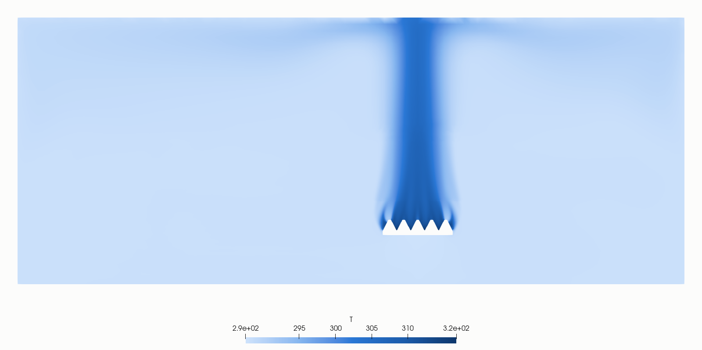
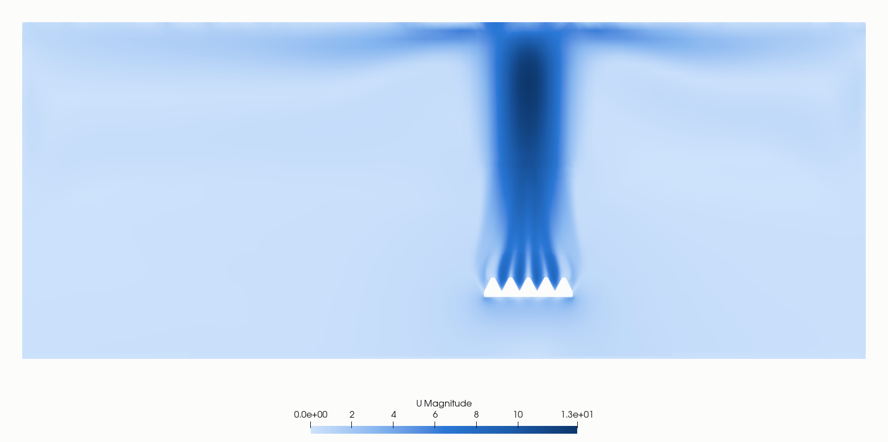
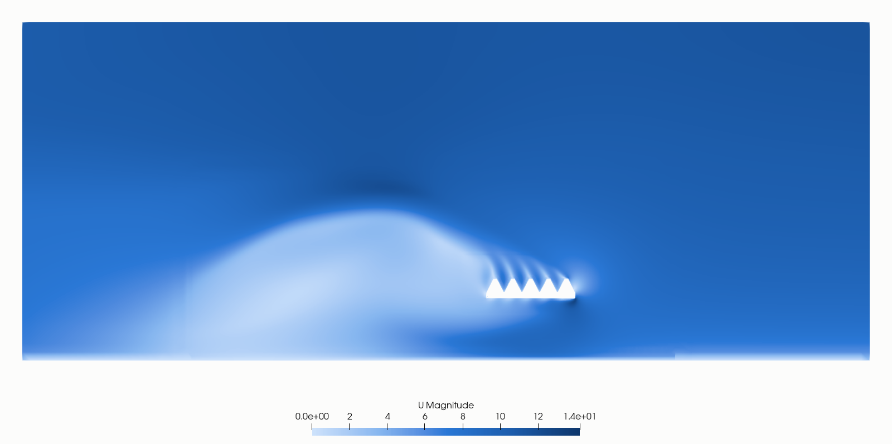

# Rapport 002-acc-5x6

**Conclusie:** alleen windstil is af. Wind en scherm zijn niet stabiel gedraaid, dus de vergelijking met en zonder wind en scherm is er niet. Het criterium "drie cases vergelijkbaar op dezelfde mesh" is niet gehaald.

## Methode
Generiek model van een luchtgekoelde condensor (ACC) met 30 A-frame-units in 5 bij 6, steek 12,6 m, dek op 45 m. Alle getallen zijn aannames of kalibraties, geen gegevens van een bestaande installatie.

| Onderdeel | Aanpak |
|---|---|
| Solver | OpenFOAM.org 11, `foamRun` met `fluid`, perfect gas met drijfkracht, kEpsilon, pseudo-stationair met lokale tijdstap (`localEuler`) |
| Domein | 600 x 480 x 240 m, 4,04 miljoen cellen met snappyHexMesh, 0,375 m bij de constructie |
| Fan | Ronde zone met axiale kracht uit een fancurve `dp = 250(1-(Q/800)^2)` Pa en swirl volgens Euler, per fan; Q uit de massastroom |
| Bundels | Poreus medium met kwadratische weerstand (DarcyForchheimer), tangentieel 10 keer zo hoog |
| Warmte | Vaste stoomtemperatuur 323 K, warmteoverdracht evenredig met T_stoom - T, gekalibreerd op ~12 MW per fan op de enkele unit (studie 001) |
| Randen | Windstil: open randen met hydrostatische druk. Wind: ABL-profiel 9 m/s op 45 m, z0 0,1 m, slip op zijkanten en top |
| Scherm | Kruisvormig poreus scherm onder het dek, K = 10 (aanname) |

Reproductie: `mkGeometry.py` en `case/` voor de mesh, `mkRuns.py` voor de drie runs, `job_*.sbatch` voor de Slurm-jobs. Keuzes en alle fixes staan in [NOTES.md](NOTES.md).

## Velden bekijken
Velden en mesh staan niet in git. Download ze uit de [release](https://github.com/MeindertvV/openfoam-studies/releases/tag/data-5x6-v1):

```bash
cd studies/002-acc-5x6/runs
tar xzf windstil-4M-t1000.tgz -C windstil
tar xzf wind-t300.tgz -C wind
cp -r windstil/constant/polyMesh wind/constant/
```

Open daarna `runs/windstil/windstil.foam` of `runs/wind/wind.foam` in ParaView, Case Type: Reconstructed Case.

## Acceptatie
| Criterium | Windstil | Wind | Scherm |
|---|---|---|---|
| Warmtebalans binnen 2% | -1,43% (365,0 MW lucht, 370,3 MW bundels): gehaald | geen eindresultaat | geen resultaat |
| Fandebiet binnen 10% van 500 m3/s | 492-509 m3/s, gemiddeld 503: gehaald | geen eindresultaat | geen resultaat |

## Windstil
- Mesh 4.044.022 cellen, 1200 iteraties, velden op t=1000 in `runs/windstil/windstil.foam`.
- Drukstap per fan 149-155 Pa. Totaal debiet 15.103 m3/s.
- Inlaat-T 287,5-288,1 K: gelijk aan de omgeving min adiabatische afkoeling, geen teken van recirculatie.
- Het bundeldebiet uit `cv_balans.py` (11.152 m3/s) is lager dan het fandebiet. Dat komt waarschijnlijk door dezelfde afwijking van cel-U in dunne zones als bij de fan; gebruik het fandebiet.
- Windstil draaide met `corrected`-schema's en maxCo 1, wind en scherm met `limited corrected 0.33` en maxCo 0,7.





## Wind: tussenstand, niet geconvergeerd
Waarden op iteratie 330, kort voor de ontsporing, 9 m/s op 45 m. Debiet zakte nog. Alleen als richting gebruiken.

| Rij vanaf windzijde | Debiet per fan (m3/s) | Hoogste inlaat-T (K) |
|---|---|---|
| 1 | 284-343 | 291,4 |
| 2 | 438-464 | 288,1 |
| 3 | 451-470 | 287,7 |
| 4 | 478-488 | 287,7 |
| 5 | 493-496 | 287,7 |

- Totaal 13.144 m3/s, 13% onder windstil. De windzijde verliest het meest, tot ~40%.
- De eerste rij zuigt tot 3,6 K warmere lucht aan. De oorzaak is niet onderzocht.
- `runs/wind/wind.foam` toont t=300, niet geconvergeerd.



## Waarom wind en scherm mislukten
- Elke poging ontspoort: iteratie 5, 8, 217 en 372. Scherm is gestopt bij iteratie 120 en is nooit voorbij de crashplek gekomen.
- De diagnose ziet k rond iteratie 377 springen tot 1510, en nut tot 3641, op ~(-38, 4, 72) en daarna ~(-38, 25, 70): boven de windzijde.
- Waarschijnlijke oorzaak: de hoge inlaat-nut (10-58 m2/s) komt in de fijne cellen aan en maakt het expliciete deel van de viscositeitsterm daar instabiel. Niet bewezen.

## Volgende stap
Lokaal op de 1,28M-mesh, zonder Azure-kosten: inlaat-k en daarmee nut begrenzen, of maxCo verlagen. Pas als dat voorbij iteratie 500 stabiel is, is een nieuwe Azure-run zinvol (ongeveer 2,5 uur op F16, ~€3 plus 10 minuten mesh).

## Kosten
Geschat ~€12,60 (~$14,50, koers niet gecontroleerd), inclusief ~€6 aan VM-tijd zonder lopende job. VM en opslag zijn verwijderd.
