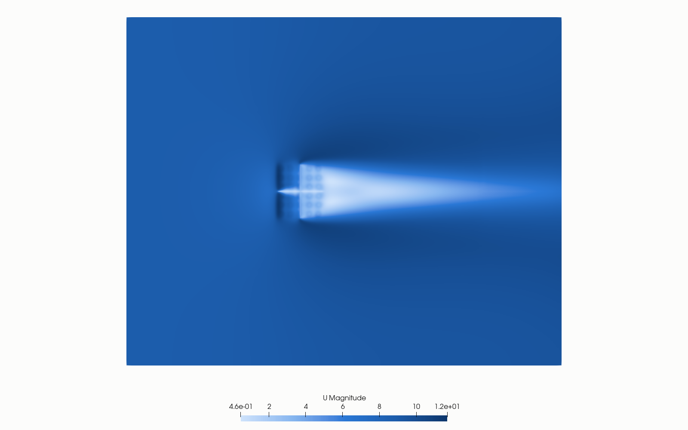
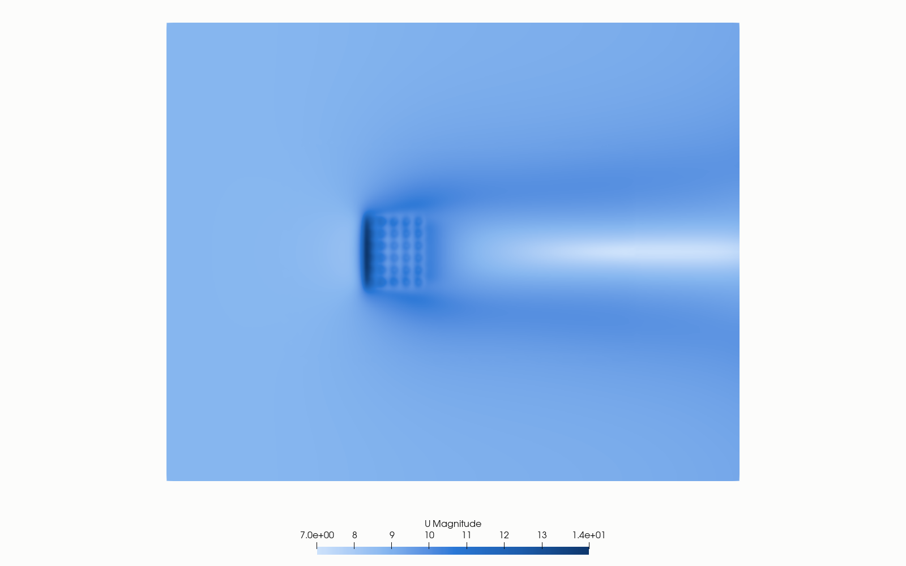

# Rapport 002-acc-5x6

**Conclusie:** de windschermen helpen bij wind. Op dezelfde mesh geeft wind 17% minder debiet dan windstil (12.527 tegen 15.103 m3/s), met scherm nog maar 12% minder (13.324 m3/s). Het scherm wint vooral bij de eerste rij: +31% debiet. De warmtebalans (4-5%) haalt het criterium van 2% niet, dus warmte is minder hard dan debiet. Details staan in [Wind en scherm](#wind-en-scherm).

## Methode
Generiek model van een luchtgekoelde condensor (ACC) met 30 A-frame-units in 5 bij 6, steek 12,6 m, dek op 45 m. Alle getallen zijn aannames of kalibraties, geen gegevens van een bestaande installatie.

| Onderdeel | Aanpak |
|---|---|
| Solver | OpenFOAM.org 11, `foamRun` met `fluid`, perfect gas met drijfkracht, kEpsilon, pseudo-stationair met lokale tijdstap (`localEuler`) |
| Domein | 600 x 480 x 240 m, 4,04 miljoen cellen met snappyHexMesh, 0,375 m bij de constructie |
| Fan | Ronde zone met axiale kracht uit een fancurve `dp = 250(1-(Q/800)^2)` Pa en swirl volgens Euler, per fan; Q uit de massastroom |
| Bundels | Poreus medium met kwadratische weerstand (DarcyForchheimer), tangentieel 10 keer zo hoog |
| Warmte | Vaste stoomtemperatuur 323 K, warmteoverdracht evenredig met T_stoom - T, gekalibreerd op ~12 MW per fan op de enkele unit (studie 001) |
| Randen | Windstil: open randen met hydrostatische druk. Wind: ABL-profiel 9 m/s op 45 m, z0 0,1 m, slip op zijkanten en top |
| Scherm | Kruisvormig poreus scherm onder het dek, z 5–44,25 m, K = 10 (aanname). Effectief vanaf z 6; de rij z 6–9 is 3 m dik omdat de cellen daar grof zijn |

Reproductie: `mkGeometry.py` en `case/` voor de mesh, `mkRuns.py` voor de drie runs, `job_*.sbatch` voor de Slurm-jobs. Keuzes en alle fixes staan in [NOTES.md](NOTES.md).

## Velden bekijken
Velden en mesh staan niet in git. Download ze uit de [release](https://github.com/MeindertvV/openfoam-studies/releases/tag/data-5x6-v1):

```bash
cd studies/002-acc-5x6/runs
tar xzf windstil-4M-t1000.tgz -C windstil
tar xzf wind-t300.tgz -C wind
cp -r windstil/constant/polyMesh wind/constant/
```

Wind en scherm met begrensde inlaat-nut en het scherm op z 5–44,25 m staan in de [release v2](https://github.com/MeindertvV/openfoam-studies/releases/tag/data-5x6-v2):

```bash
cd studies/002-acc-5x6/runs
tar xzf wind_v2-t1200.tgz -C wind_v2
tar xzf scherm_v2-t1200.tgz -C scherm_v2
```

Open daarna `runs/windstil/windstil.foam`, `runs/wind_v2/wind_v2.foam` of `runs/scherm_v2/scherm_v2.foam` in ParaView, Case Type: Reconstructed Case.

Poreuze zones, zoals het scherm (`screen`) en de bundels, zijn geen wanden en staan dus niet tussen de patches. Je ziet ze door in ParaView **Read Zones** aan te zetten (tandwiel naast de zoekbalk in Properties) en ze daarna onder Mesh Regions aan te vinken. Getest met ParaView 6.2; in 5.10 verscheen de zone niet in de lijst.

## Acceptatie
| Criterium | Windstil | Wind | Scherm |
|---|---|---|---|
| Warmtebalans binnen 2% | -1,43% (365,0 MW lucht, 370,3 MW bundels): gehaald | -5,26% (308,9 / 326,0 MW): niet gehaald | -4,15% (330,4 / 344,7 MW): niet gehaald |
| Fandebiet binnen 10% van 500 m3/s | 492-509, gemiddeld 503: gehaald | 259-472, gemiddeld 418: niet gehaald | 371-484, gemiddeld 444: niet gehaald |
| Vergelijkbaar op dezelfde mesh | ja | ja | ja |

Wind en scherm horen het debietcriterium niet per se te halen: wind verlaagt het debiet juist. Het criterium geldt strikt voor windstil.

## Windstil
- Mesh 4.044.022 cellen, 1200 iteraties, velden op t=1000 in `runs/windstil/windstil.foam`.
- Drukstap per fan 149-155 Pa. Totaal debiet 15.103 m3/s.
- Inlaat-T 287,5-288,1 K: gelijk aan de omgeving min adiabatische afkoeling, geen teken van recirculatie.
- Het bundeldebiet uit `cv_balans.py` (11.152 m3/s) is lager dan het fandebiet. Dat komt waarschijnlijk door dezelfde afwijking van cel-U in dunne zones als bij de fan; gebruik het fandebiet.
- Windstil draaide met `corrected`-schema's en maxCo 1, wind en scherm met `limited corrected 0.33` en maxCo 0,7.


## Wind en scherm
9 m/s op 45 m, 1200 iteraties, velden op t=1200 in `runs/wind_v2/wind_v2.foam` en `runs/scherm_v2/scherm_v2.foam`. Rij 1 is de windzijde.

| Rij | Debiet per fan windstil | Wind | Wind + scherm | Hoogste inlaat-T wind | Met scherm |
|---|---|---|---|---|---|
| 1 | 500-506 | 259-334 | 371-392 | 290,3 K | 289,9 K |
| 2 | 504-509 | 420-443 | 461-484 | 289,7 K | 288,6 K |
| 3 | 492-498 | 435-449 | 430-444 | 290,8 K | 288,1 K |
| 4 | 504-509 | 456-467 | 455-460 | 291,2 K | 288,0 K |
| 5 | 501-506 | 468-472 | 466-478 | 291,0 K | 288,0 K |

| Totaal | Windstil | Wind | Wind + scherm |
|---|---|---|---|
| Debiet (m3/s) | 15.103 | 12.527 | 13.324 |
| Warmte in lucht (MW) | 365 | 309 | 330 |
| Drukstap per fan (Pa) | 149-155 | 163-224 | 159-196 |

- Het scherm wint +6,4% debiet en ongeveer +7% warmte op wind alleen. De winst zit in rij 1 en 2; rij 3-5 veranderen in debiet nauwelijks.
- Het scherm verlaagt ook de inlaat-T in rij 2-5 met 1-3 K; vermoedelijk komt daar minder warme lucht terug. Niet onderzocht.
- **Convergentie:** residuen dalen tot het einde (U ~2e-4, p_rgh ~7e-3 bij iteratie 1100), zonder ontsporing, maar ze zakken nog. Het verloop van debiet en T per iteratie is niet bewaard, dus stabiliteit van de eindwaarden is niet aangetoond.
- **Warmtebalans:** de fout van 4-5% is groter dan het verschil tussen de varianten bij warmte, dus die +7% is een richting. Het debiet komt uit `fans_csv.py` en heeft die fout niet.
- Windstil draaide met andere schema's en maxCo (zie boven), dus de vergelijking met windstil is iets minder strikt dan die tussen wind en scherm.
- K = 10 van het scherm is een aanname. Een ander K verandert de winst.





## Wat de instabiliteit oploste
De eerdere runs ontspoorden bij iteratie 5, 8, 217 en 372. Met de inlaat-nut begrensd op 5 m2/s (via epsilon) draaiden beide 1200 iteraties zonder fout. Dat steunt de eerdere verklaring, maar het bewijst hem niet: er is geen 4M-controlerun zonder begrenzing tot 1200 iteraties met verder dezelfde instellingen. De begrenzing raakt de turbulentie van de inkomende wind boven de inlaat.

Oude runs staan nog in `runs/wind` (t=300) en `runs/scherm`.

## Volgende stap
Warmtebalans onder 2% krijgen, of K van het scherm variëren. Daarvoor is een andere meting of een nieuwe run nodig.

## Kosten
Geschat ~€12,60 (~$14,50, koers niet gecontroleerd), inclusief ~€6 aan VM-tijd zonder lopende job. VM en opslag zijn verwijderd. Run wind_v2 en scherm_v2: ~€4,40 (3,6 uur F16as_v6), budget $10. Totaal ~€17.
